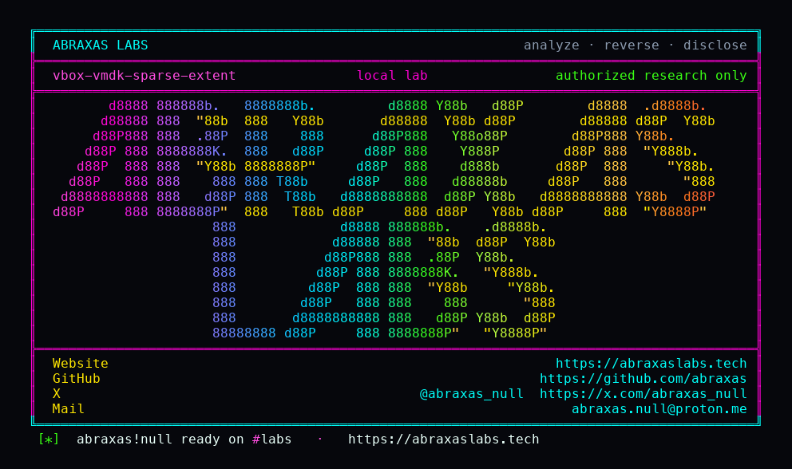

<p align="center">
  
</p>

<p align="center">
  <a href="https://abraxaslabs.tech"><strong>abraxaslabs.tech</strong></a>
  &nbsp;·&nbsp;
  <a href="https://github.com/abraxas">github.com/abraxas</a>
  &nbsp;·&nbsp;
  <a href="https://x.com/abraxas_null">@abraxas_null</a>
  &nbsp;·&nbsp;
  <a href="mailto:abraxas.null@proton.me">abraxas.null@proton.me</a>
  &nbsp;·&nbsp;
  <a href="https://github.com/abraxas/vbox-vmdk-sparse-extent">vbox-vmdk-sparse-extent</a>
</p>
<p align="center">
  Write-up: <a href="https://abraxaslabs.tech/research/virtualbox-7-2-20-leftovers"><strong>https://abraxaslabs.tech/research/virtualbox-7-2-20-leftovers</strong></a>
</p>


# vbox-vmdk-sparse-extent

**Class:** File read
**Reach:** Local (host) UI:R

**Oracle VM VirtualBox OSS** `7.2.20` (`f2792cf44`) - Oracle

A host user who imports an OVF directory or OVA whose disk is a sparse VMDK descriptor plus FLAT extent opens a host path named in that extent and copies those bytes into the imported disk. After `vmdkParseDescriptor`, each extent with `pszBasename` starting with `RTPATH_SLASH` is used as-is; otherwise `RTPathJoinA(descriptor dir, pszBasename)` which follows `../`. FLAT and HOSTED_SPARSE then `vmdkFileOpen` that full path. streamOptimized (usual VirtualBox export, VMDK magic) is a single file and does not take this walk. Import still accepts the sparse specifier.

| | |
|---|---|
| ID | no CVE yet |
| Class | **File read** (sparse VMDK FLAT/sparse extent path) |
| Reach | **Local (host)** UI:R (victim imports a hostile appliance) |
| CWE | [CWE-22](https://cwe.mitre.org/data/definitions/22.html) |
| CVSS | **High: 7.7** `CVSS:3.1/AV:L/AC:L/PR:N/UI:R/S:C/C:H/I:N/A:N` |
| Product | [Oracle VM VirtualBox OSS](https://github.com/VirtualBox/virtualbox) |
| Affected | **7.2.20** (`f2792cf44f663989818507e36d3db5f978523c5e`) |
| Auth | none on VirtualBox. The host user opens File/Import or `VBoxManage import`. |
| License | [GNU Affero GPL v3.0](LICENSE) |
| Lab | `127.0.0.1` only. Source harness. VirtualBox is not booted. |

## What an attacker can do

Ship an OVF directory or an OVA. Put a sparse VMDK descriptor (`# Disk DescriptorFile`, `createType="monolithicFlat"`) next to a FLAT extent whose quoted basename is `../../somewhere/secret` or `/path/secret`. The operator who imports it opens that host path as the importing UID and copies the bytes into the dest disk. streamOptimized (VMDK magic `0x564D444B`) does not consult the embedded FLAT name. This is a read of files the VBox UID can open, not a suffix-free write of `authorized_keys`.

| Privilege | Method + sink | What it grants | Provenance |
|---|---|---|---|
| Recon | Import of an ASCII sparse VMDK. After `vmdkParseDescriptor`, `RTPathJoinA(descriptor dir, pszBasename)` with no `../` collapse (`VMDK.cpp` 3472-3503). FLAT `vmdkFileOpen` of that full path. Import copies those bytes into dest. | Host file bytes named by `../` land in the imported disk. Lab `pszBasename` `../../oracle/VBOX-VMDK-SPARSE-EXTENT-WITNESS` joined to `/work/import/disk/../../oracle/...` and copied into `/work/import/out.vmdk`. | Lab-proven (`relative-escape=yes`) |
| Recon | Same walk. `pszBasename[0] == RTPATH_SLASH` is used as-is (`VMDK.cpp` 3477-3485). | Absolute host path opened and copied. Lab `/work/oracle/VBOX-VMDK-SPARSE-EXTENT-WITNESS`. | Lab-proven (`absolute-extent=yes`) |
| Recon | Control FLAT `disk-flat.vmdk` joined under the descriptor directory. | Stays in-folder. Lab fullname `/work/import/disk/disk-flat.vmdk`. Bytes `CONTROL-FLAT-NOT-ORACLE`. | Lab-proven (`control-in-folder=yes`) |
| Recon | streamOptimized with VMDK magic. `vmdkDescriptorRead` takes `vmdkDescriptorReadSparse`. Embedded ASCII FLAT named the oracle. | Did not open the embedded name. Dest stayed the stream file (`STREAMOPTIMIZED-SELF-NOT-ORACLE`). | Lab-proven (`streamoptimized-consults-extent=no`) |
| Recon | Guest Start, then read the converted volume. | Guest sees importer-UID-readable host file contents that landed in dest. | Inferred (same copy; lab does not boot a guest) |
| Availability | Import dest that already exists, or a later attach of the converted disk. | Overwrite availability of dest disk. Contents become the opened host file. | Inferred (same write of dest) |
| Closed | streamOptimized VMDK (usual VirtualBox export) | Magic branch. Single file. Embedded FLAT name is not opened. | Closed |
| Closed | Windows drive-letter absolute (`C:\...`) | May miss `pszBasename[0] == RTPATH_SLASH`. The code calls the absolute check a hack (`@todo implement proper path absolute check`). | Closed |
| Closed | Suffix-free writes (`authorized_keys`, crontab) | Not a write leftover. Extent open is a read of the named host path. | Closed |
| Closed | Host kernel, guest-to-host, other VMs, VBoxSVC memory | Not this leftover. No VM start required for the copy. Same UID as the importer. | Closed |

OVA is the same walk once the sparse descriptor is on disk: tar member supplies the descriptor plus (optional) in-folder FLAT; the extent basename supplies the escaped open. No 3D, no Guest Additions, no VRDP, not PUEL.

## How I found it

I sat on tag `v7.2.20` (`f2792cf44`) after the Sep 2026 CPU and read VMDK import. ExtraData, shared folders, NVRAM dest, and serial RawFile are already stripped. `ovf:href` dest is a sibling leftover. The usual VirtualBox export is streamOptimized. `interpret()` still accepts the sparse specifier (`g_pszVMDKSparseURI`). After `vmdkParseDescriptor`, the extent basename is joined without collapsing `../` or rejecting absolute paths:

```cpp
/* Hack to figure out whether the specified name in the
 * extent descriptor is absolute. Doesn't always work, but
 * should be good enough for now. */
char *pszFullname;
/** @todo implement proper path absolute check. */
if (pExtent->pszBasename[0] == RTPATH_SLASH)
{
    pszFullname = RTStrDup(pExtent->pszBasename);
    /* ... */
}
else
{
    char *pszDirname = RTStrDup(pImage->pszFilename);
    RTPathStripFilename(pszDirname);
    pszFullname = RTPathJoinA(pszDirname, pExtent->pszBasename);
    /* ... */
}
pExtent->pszFullname = pszFullname;
```

`RTPathJoinA` slash-balances only. It does not collapse `..`. FLAT and HOSTED_SPARSE then open that string:

```cpp
case VMDKETYPE_FLAT:
    rc = vmdkFileOpen(pImage, &pExtent->pFile, pExtent->pszBasename, pExtent->pszFullname,
                      VDOpenFlagsToFileOpenFlags(uOpenFlags, false /* fCreate */));
```

`vmdkDescriptorRead` splits on magic. VMDK sparse magic (`0x564D444B`) takes `vmdkDescriptorReadSparse` and keeps the already-open file as the extent. ASCII takes `vmdkDescriptorReadAscii` and the join above.

Wrong turns already recorded: treating streamOptimized as this leftover (magic does not consult the embedded FLAT name); treating a Windows drive-letter absolute as the Unix slash check; treating dest-disk overwrite as a suffix-free `authorized_keys` write; booting a VM when the source harness of the join is enough. Theatre: host kernel, guest-to-host. The oracle is a witness line outside the descriptor folder plus a control `disk-flat.vmdk` that stayed put.

## Lab

```bash
python3 vbox-vmdk-sparse-extent-Abraxas-Labs.py
```

or

```bash
cd lab
./run.sh
```

Source harness of `vmdkParseDescriptor` extent join, `vmdkFileOpen`, and the streamOptimized magic branch. Docker compose, loopback `127.0.0.1:19250`, no VirtualBox binary. Descriptor dir `/work/import/disk`. Oracle `/work/oracle`. Dest `/work/import/out.vmdk`.

```text
SUCCESS vbox-vmdk-sparse-extent relative-escape=yes absolute-extent=yes control-in-folder=yes VBOX-VMDK-SPARSE-EXTENT-WITNESS
```

## The fix

Collapse or reject `..` in `pszBasename`. Reject absolute `pszBasename`. Or open extents only under the descriptor directory (`RTPATHABS_F_STOP_AT_BASE` / realpath-under-base). Do not treat `pszBasename[0] == RTPATH_SLASH` as a complete absolute check.

## References

- [github.com/VirtualBox/virtualbox](https://github.com/VirtualBox/virtualbox) tag [v7.2.20](https://github.com/VirtualBox/virtualbox/releases/tag/v7.2.20) (`f2792cf44f663989818507e36d3db5f978523c5e`)
- [`VMDK.cpp`](https://github.com/VirtualBox/virtualbox/blob/f2792cf44f663989818507e36d3db5f978523c5e/src/VBox/Storage/VMDK.cpp) `vmdkDescriptorReadSparse` 3312, `vmdkDescriptorReadAscii` extent join 3472-3547, `vmdkDescriptorRead` 3576-3589
- [`ApplianceImpl.cpp`](https://github.com/VirtualBox/virtualbox/blob/f2792cf44f663989818507e36d3db5f978523c5e/src/VBox/Main/src-server/ApplianceImpl.cpp) `g_pszVMDKSparseURI` 61, 78
- [`ApplianceImplImport.cpp`](https://github.com/VirtualBox/virtualbox/blob/f2792cf44f663989818507e36d3db5f978523c5e/src/VBox/Main/src-server/ApplianceImplImport.cpp) `i_importOneDiskImage` 4343-4408
- [CWE-22](https://cwe.mitre.org/data/definitions/22.html)

## License

GNU Affero GPL v3.0. See [LICENSE](LICENSE). Loopback lab only. No warranty.
